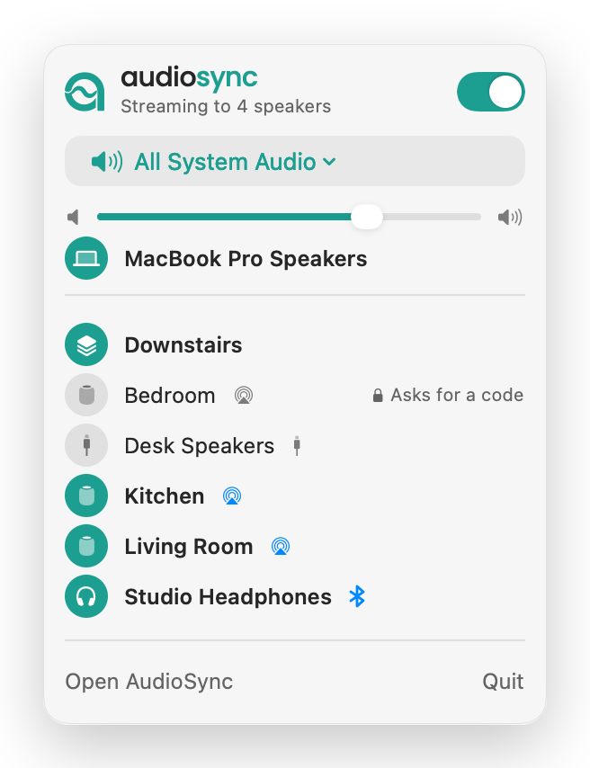
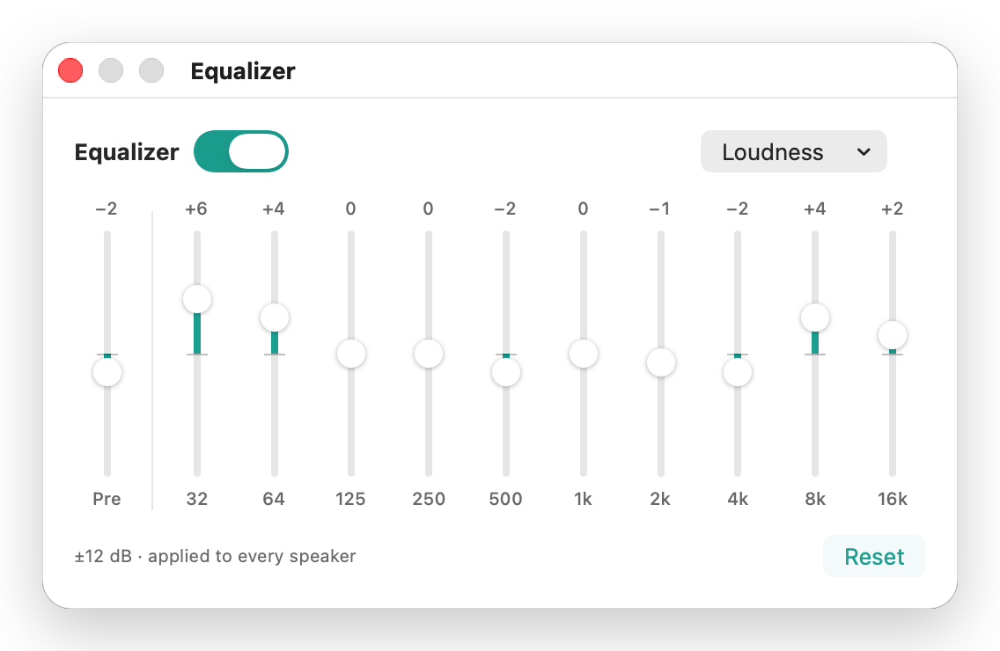

<p align="center">
  <picture>
    <source media="(prefers-color-scheme: dark)" srcset="brand/audiosync-icon-dark.svg">
    
  </picture>
  <br>
  <picture>
    <source media="(prefers-color-scheme: dark)" srcset="brand/audiosync-wordmark-dark.svg">
    
  </picture>
</p>

<p align="center">
  A free, open-source Airfoil alternative for macOS: play your Mac's audio on HomePods, AirPlay speakers and every local output at once, in sync.
</p>

<p align="center">
  <a href="https://github.com/yassersutojoyo/audiosync/actions/workflows/ci.yml"></a>
  <a href="https://github.com/yassersutojoyo/audiosync/actions/workflows/windows.yml"></a>
  
  
  
</p>

<p align="center">
  <picture>
    <source media="(prefers-color-scheme: dark)" srcset="docs/images/main-window-dark.png">
    
  </picture>
</p>

I built this because I wanted my Mac's audio on every speaker in the house at once. The catch is that a HomePod always plays a little late (AirPlay buffers about two seconds), so a HomePod and a desk speaker playing the same song sound like an echo. AudioSync captures the audio once, streams it to your AirPlay speakers, and plays a delayed copy on each local output, every one with its own offset, until the whole room sounds like one speaker.

It's a small Mac app written in Swift, with a main window and a menu bar panel, free and open source under the GPL. It's an early alpha, so expect rough edges. A Windows 11 version is on the way too ([more below](#coming-to-windows)).

## What's in the download, and what's next

The download today is 0.4.1. Since then I've rebuilt a lot of the insides, and the next version brings that work out of `main`:

- A new audio engine written in Rust, shared with the Windows version.
- Delays that work with local speakers alone, with the Mac's built-in speakers as the reference. No AirPlay speaker needed to line up a Bluetooth speaker with your Mac.
- A hint on any speaker you switched on that sits at 25% or less, or muted, in macOS, with a one-click fix.
- Short fades when audio starts and stops, so speakers don't click.
- The track that's playing (title, artist, album, artwork) on AirPlay speakers with a screen, like a TV.

The rest of this README describes the app as it is on `main`, which is what the next version will be. [`CHANGELOG.md`](CHANGELOG.md) has the full list under Unreleased.

## Multi-room audio on macOS

The source can be all system audio, a single app (with its helper processes, like a browser's audio service), or an input device such as a microphone, line-in or audio interface (first two channels). It plays to one or more HomePods, Apple TVs and other AirPlay receivers, plus anything macOS can play to: built-in speakers, the headphone jack, HDMI/DisplayPort, USB DACs and Bluetooth.

Each local speaker gets its own delay relative to the Mac's built-in speakers (−2 to +20 s), and it applies whether or not an AirPlay speaker is on. There's one AirPlay delay for lining the Mac up with the AirPlay speakers, and the AirPlay speakers are kept in step with each other. On top of that you get per-speaker and master volume, a 10-band equalizer with a preamp and presets, Now Playing for Spotify and Music (also shown on AirPlay TVs and other speakers with a screen), speaker groups, auto-connect, and launch at login. An Apple TV that asks for a PIN pairs once, and an older AirPlay speaker with a password asks for it when you turn it on.

macOS also keeps its own volume for every output, and only the default one is in the Sound menu. If a speaker you switched on sits at 25% or less there, or is muted, its row tells you, and one click sets it to 75% or unmutes it.

## Coming to Windows

There's a Windows 11 version too, written in Rust with a [Slint](https://slint.dev) interface, for x64 and ARM64 PCs. It shares the Rust audio engine with the Mac app, and by now it does most of what the Mac app does.

The part I'm proudest of: AirPlay on Windows goes out through AudioSync's own AirPlay sender, written from scratch in Rust and built right into the app. There's no separate AirPlay engine to bundle, install or keep running, and it finds speakers on its own, without Bonjour or other Apple software on the PC. Here's what it does today:

- It captures everything the PC plays (except AudioSync itself), or just one app.
- It plays to several of the PC's outputs at once, in sync: speakers, headphones, USB, HDMI and Bluetooth, each with its own delay relative to the built-in output, and its own volume under a master volume.
- It plays to AirPlay speakers through that built-in sender, and the PC's outputs wait for them so everything stays in step. An Apple TV that asks for a code gets a PIN prompt and remembers the pairing.
- Groups, auto-connect, and the same ten-band equalizer with a preamp and presets.
- The same hint as on the Mac when a speaker you turned on sits very low or muted in Windows, with the same one-click fix.
- A tray icon with a flyout, like the Mac's menu bar panel. Closing the window keeps it running there.
- Keyboard shortcuts and Narrator support ([`docs/WINDOWS_UI.md`](docs/WINDOWS_UI.md) lists them).
- Notices in the window instead of popups, for things like a speaker that went away, an output another app holds for itself, or no working sound output.
- One copy at a time: opening it again brings the running window forward.
- Your settings are kept between launches, and a settings or pairing file it can't read is set aside as a copy instead of being overwritten.
- A debug log you can switch on when something acts up.

It isn't released yet, so there's no download on the Releases page today. It can go out with an upcoming release as an unsigned preview, once I've tried that exact build on a real Windows 11 PC. CI builds and tests it on every push, and if you're signed in to GitHub you can grab a build from there; [windows/README.md](windows/README.md#trying-the-preview-exe) says where and what to expect the first time (it needs Windows 11, isn't code-signed, and wants a Private network for AirPlay).

To be upfront about the gaps: from Windows, AirPlay only plays to receivers that take AirPlay 1. Receivers that only do AirPlay 2, or that ask for a password, are listed with a note and stay off. I haven't tried the AirPlay part with a real speaker or Apple TV yet. Local playback has had a short first listen on my Windows 11 PC, a USB-C in-ear and a pair of wired speakers playing together; Bluetooth speakers are next on my list.

## Coming from Airfoil?

If you've used Airfoil, the idea will feel familiar: send the whole system's audio, or just one app, to AirPlay speakers and the Mac's own outputs at the same time, with each local speaker lined up so nothing echoes. AudioSync is free and open source, but it does less. It only streams to AirPlay receivers and outputs macOS already knows about, so there's no Chromecast or other kinds of network speakers. It needs macOS 15 or later, everything runs about two seconds behind, and it's still an alpha.

To be clear: Airfoil is a product of Rogue Amoeba. AudioSync isn't affiliated with them or endorsed by them, and it shares no code with Airfoil.

## Install

Download `AudioSync.dmg` from the [latest release](https://github.com/yassersutojoyo/audiosync/releases/latest) and drag the app to Applications. It runs on macOS 15 (Sequoia) or later, AirPlay included. That's 0.4.1 for now; the changes above come with the next version, or you can build `main` yourself.

I don't have a paid Apple developer account, so releases aren't notarized and macOS blocks the first launch. Open AudioSync once, dismiss the warning, then go to System Settings → Privacy & Security and click Open Anyway next to the message about AudioSync. (Or run `xattr -dr com.apple.quarantine /Applications/AudioSync.app`.) Each release lists SHA-256 checksums for its files.

AudioSync doesn't update itself. To update, quit AudioSync and replace the app with the one from [Releases](https://github.com/yassersutojoyo/audiosync/releases). [`CHANGELOG.md`](CHANGELOG.md) has what changed.

You can also build it yourself, on macOS 15 or later. You need the Xcode 16 command line tools and a Rust toolchain ([rustup](https://rustup.rs), or Homebrew's rustup), then:

```bash
git clone https://github.com/yassersutojoyo/audiosync
cd audiosync
./setup.sh
```

The first run takes a few minutes: it builds the Rust audio core and the app, then installs it. [`docs/DEVELOPMENT.md`](docs/DEVELOPMENT.md) has the details, plus how to uninstall.

On first use macOS asks for Screen & System Audio Recording (choose System Audio Recording Only) to capture audio, and Local Network to find AirPlay speakers. Microphone access is only needed for an input source, and Automation (Spotify, Music) only for Now Playing.

For HomePods, set Home app → Home Settings → Speakers & TV → Allow Speaker & TV Access to "Anyone on the Same Network", on a network you trust. Avoid "Everyone", which lets any nearby device stream.

## Using it

Leave the macOS sound output on a local device. Don't pick a HomePod in Control Center or in your player; AudioSync streams to AirPlay speakers itself.

The main window opens when AudioSync starts (not when it launches at login; click the Dock icon to bring it back). Pick an audio source, then turn speakers on by clicking their round icons. The list goes:

- **This Mac**: the Mac's own speakers and headphone jack
- your groups
- **Connected Speakers**: AirPlay, Bluetooth, USB, HDMI and every other output, by name, each with a small icon for its kind that turns to color while it plays

The switch at the top turns all streaming on or off. Switching it off keeps your speakers chosen (they show as "will play") and they come back when you switch it on again.

The Mac's built-in speakers are the reference, so they have no delay. Every other local speaker has a delay relative to them (like ⏱ +150 ms), and it always applies, with or without AirPlay. If a speaker plays before the built-in speakers, raise its delay; if it plays after them, lower it, below zero if needed. Bluetooth speakers and headphones run late, so they usually end up around −150 to −300 ms. Then, with an AirPlay speaker on, there's the AirPlay delay under Connected Speakers (it starts at the latency AirPlay reports, a little under two seconds): if the Mac plays first and the HomePod echoes behind it, raise it; if the HomePod plays first, lower it. Stop when you hear one clean sound; the values are saved. Music with clear claps or drums makes it easier, and so does adding speakers one at a time. Delays you set in an older version are carried over once.

<p align="center">
  <picture>
    <source media="(prefers-color-scheme: dark)" srcset="docs/images/menu-bar-panel-dark.png">
    
  </picture>
</p>

The menu bar icon opens a compact panel with the power switch, source, master volume and every speaker and group; click a row to switch it. When something needs attention, like a speaker that got switched off or a source app that quit, a notice shows at the top of the window and the panel, and a dot appears next to the menu bar icon. Notices clear themselves once the cause is gone, or you can dismiss them.

A few other things worth knowing:

- Right-click a speaker (or use its ⋯ button) for auto-connect, and a group to rename or delete it.
- The gear menu has New Group from Active Speakers, Refresh Devices, Show Virtual Devices (loopback drivers, meeting apps and other virtual outputs stay hidden until you turn this on or already use one), Appearance, Launch at Login and the AudioSync Guide.
- Clicking any speaker while streaming is off starts streaming. Click a delay to nudge it by ±10/±100 ms or type a value (a leading − for a negative one).
- Speakers that want a PIN or password (an Apple TV, or a receiver with Require Password on) are marked "Asks for a code". You get a prompt when you turn one on yourself. An Apple TV pairs once and then connects without a code; a password is asked for once each time AudioSync starts.
- If AirPlay can't start, or stops after an error, Connected Speakers says so and offers a Retry button.

<p align="center">
  <picture>
    <source media="(prefers-color-scheme: dark)" srcset="docs/images/equalizer-dark.png">
    
  </picture>
</p>

## How it works, briefly

System or app audio comes in through a Core Audio process tap (which also mutes the original output, so you only hear the synced copies); input devices are read directly. The audio goes through the equalizer into a shared buffer. Each local speaker has its own output unit reading that buffer at its own delay and correcting clock drift. The same audio is streamed to the AirPlay speakers.

An Apple TV that asks for a PIN pairs once, with the PIN it shows, and a speaker with a password asks for it when you turn it on. [`SECURITY.md`](SECURITY.md) goes into the details.

## Known limitations

- Everything is about two seconds late because of the AirPlay buffer. Fine for music, not for video or games.
- AirPlay goes out as classic AirPlay (AirPlay 1), which most AirPlay 2 speakers still take; a speaker that only speaks AirPlay 2 isn't listed yet.
- Now Playing only works with Spotify and Music; macOS doesn't let other apps read the system-wide Now Playing info.

## License and credits

Copyright (c) 2026 Yasser Sutojoyo Kusumo

AudioSync is free software: you can redistribute it and/or modify it under the terms of the GNU General Public License as published by the Free Software Foundation, either version 3 of the License, or (at your option) any later version (GPL-3.0-or-later). It comes with no warranty. The full text is in [`LICENSE`](LICENSE).

What the app bundles from others keeps its own license; [`THIRD_PARTY_NOTICES.md`](THIRD_PARTY_NOTICES.md) lists everything.

The wordmark typeface, [Poppins](https://github.com/itfoundry/Poppins) (SIL Open Font License 1.1), is bundled in the app.

AudioSync is an independent project. It is not affiliated with, endorsed by, or based on code from Rogue Amoeba; Airfoil is a trademark of Rogue Amoeba Software, LLC, mentioned only to say what AudioSync is an alternative to. Apple, AirPlay and HomePod are trademarks of Apple Inc. The Bluetooth® word mark and logos are registered trademarks owned by Bluetooth SIG, Inc. AudioSync is not affiliated with or endorsed by Apple or Bluetooth SIG.

Want to build it, hack on it or report something? See [`docs/DEVELOPMENT.md`](docs/DEVELOPMENT.md), [`CONTRIBUTING.md`](CONTRIBUTING.md) and [`SECURITY.md`](SECURITY.md).
