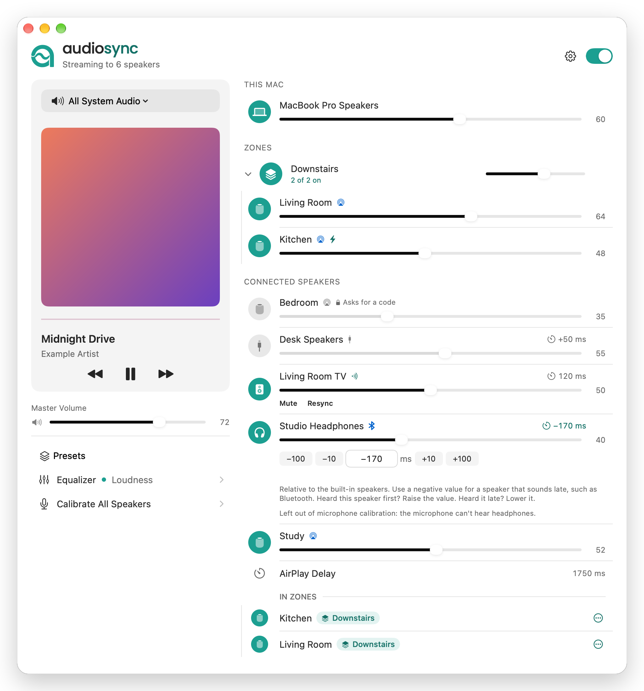

  <picture>
    <source media="(prefers-color-scheme: dark)" srcset="brand/audiosync-icon-dark.svg">
    
  </picture>
   
  <picture>
    <source media="(prefers-color-scheme: dark)" srcset="brand/audiosync-wordmark-dark.svg">
    
  </picture>

  Multiroom audio for macOS, Windows and Linux: play your computer's sound on AirPlay speakers, Bluetooth speakers and every other output it knows, plus Google Cast, all at once and in sync. A free, open-source Airfoil alternative.

  
  
  
  
  
  
  

  <picture>
    <source media="(prefers-color-scheme: dark)" srcset="docs/images/main-window-dark.png">
    
  </picture>

AirPlay speakers play about two seconds late. Local speakers don't. Play the same song on both and you get an echo.

AudioSync fixes that. It grabs your computer's audio once, sends it to your AirPlay speakers, and plays a delayed copy on each local speaker, so they all line up. It's free, and it's a beta, so expect rough edges.

- On a Mac (macOS 15 or later) it plays system audio, one app or a mic on AirPlay speakers, Google Cast speakers, Bluetooth and every other output the Mac knows.
- On Windows 11 it's multiroom audio for your PC: it plays the PC's audio on AirPlay speakers, sends desktop audio to a Google Cast speaker, and keeps Bluetooth and the other Windows outputs in sync with them.
- On Linux it's an AirPlay sender that also plays to Google Cast and keeps Bluetooth and AirPlay speakers in sync, through PipeWire. It's out since 0.8.5.

## New in 0.8.5

- It runs on Linux too: an AppImage for x86_64 and aarch64 that updates itself, plus a .deb.
- One-line installs for Windows (PowerShell) and Linux (terminal), next to the Mac's Terminal one. Each checks the download before it installs anything.
- Notices about something that failed now say what to do next, like freeing up disk space or closing the app that holds port 319 or 320.
- The Mac and Windows apps work more alike, down to the menus, prompts and notices.
- Still worth knowing from 0.8: AirPlay 2-only speakers, stereo pairs and home theater groups play out of the box, up to 16 at once, and the Windows version updates itself (Help > Check for Updates…).

## New in 0.7

The Windows parts are in the Windows version, out since 0.7.1.

- Web Remote: turn it on and a phone on your home network can switch speakers on and off and set volumes and delays. It's plain HTTP, so keep it at home. I'd leave it off whenever the computer is on a network you share with strangers, like cafe, hotel or office guest Wi-Fi.
- Calibrate All Speakers measures the speakers that are on, one after the other, and lets you apply or undo the new delays in one go. It leaves out headphones and virtual outputs, since the microphone can't hear them.
- Zones instead of groups: a zone has its own volume, one click turns its speakers on or off, and Calibrate Zone measures just that zone. Your groups turn into zones by themselves.
- Presets: save which speakers are on with their volumes and EQ curve, and recall it all in one click or with a shortcut.
- Several apps as one source, or every app except the ones you check.
- Audio interfaces with more than two inputs: pick which channel pair plays, under Input Channels.
- A mic or line in works as a source, and a level meter under the source shows it's coming in. With only local speakers on, the delay stays low. Turn on an AirPlay or Cast speaker and every speaker plays in step, about 2 seconds after the input.
- Save your own EQ curves next to the presets.
- The Web Remote can switch the source, zones and presets too.
- On the Mac, a Bluetooth headset's call microphone isn't offered as a source anymore, since using it drops the headset to call quality.
- Calibrate with Microphone works on Windows too.
- Master Volume turns Google Cast speakers and groups down too.
- A Cast speaker that doesn't show up can be added by its IP address or host name, with Add by Address… under Connected Speakers on the Mac or in the Speakers menu on Windows.
- Cast speakers show the track that's playing, with the title, artist, album and cover.
- On Windows you can rename a speaker too, with a double-click on its name.
- Hide Speaker takes a speaker you never use out of the list, and Hidden Speakers brings it back.

## New in 0.6

- Google Cast speakers, on the Mac and on Windows, one at a time. You set each one's offset by ear, and Resync restarts it if it drifts.
- Cast and AirPlay speakers together: the side that's ahead waits for the other, AirPlay up to 3 s back then (20 s now).
- On the Mac, Calibrate with Microphone sets a local speaker's delay for you.
- On the Mac, rename a speaker with a double-click on its name.
- If the app you capture quits, AudioSync can switch to all system audio instead of stopping.
- Local speakers with a clock that runs a bit fast or slow stay in time with smaller corrections.
- Diagrams in the Guide.
- AirPlay 2 is in there, still experimental then.

The rest is in [`CHANGELOG.md`](CHANGELOG.md).

## What it does

- Source: all system audio, one app, several apps (or every app except the ones you check), or an input device (mic, audio interface).
- Outputs: AirPlay speakers, Apple TVs, Google Cast speakers, and anything your computer can play to (built-in, headphone jack, HDMI, USB, Bluetooth).
- A delay per local speaker (−2 to +20 s), plus one AirPlay delay.
- Volume per speaker and master, a 10-band EQ, zones that switch on and off together, each with its own volume, presets, Calibrate with Microphone, rename and hide speakers, auto-connect, launch at login, and the Web Remote.
- Now Playing: Spotify and Music on the Mac, any app that shows in Windows' media controls on Windows, any MPRIS player on Linux.
- On the Mac it lives in the menu bar. On Windows it's a window plus a tray icon with its own panel. On Linux it sits in the tray when your desktop has a StatusNotifier host, and runs as a plain window when it doesn't.

Everything in this list is in all three versions, except where a line says otherwise.

Like Airfoil, but less. Not made by Rogue Amoeba, no shared code.

Speakers that only do AirPlay 2 play out of the box. A speaker that does both AirPlay 1 and AirPlay 2 uses AirPlay 2, or AirPlay 1 when it was paired over AirPlay 1 or AirPlay 2 can't take it. Up to 16 AirPlay 2 speakers play at once. A stereo pair, or an Apple TV with the HomePods it plays through, shows up as one row with one volume and one delay.

Since the local speakers wait for the network ones, everything you hear is about two seconds late. Music doesn't mind. For video, a player with an audio delay setting (mpv, VLC, IINA) can hold the picture back to match.

Google Cast speakers work in every version, one at a time. Cast has no shared clock, so AudioSync can't sync them by itself: you set an offset by ear for each Cast speaker and it's remembered. If one drifts, hit Resync under its volume. That restarts the stream with a short gap, and it never happens on its own. A speaker group made in the Google Home app plays as one speaker, with one volume and one offset, and its row names the members once the group reports them. A speaker in the group keeps its own row and is busy while the group plays. When a Cast speaker and AirPlay speakers are on together, the faster side waits for the slower one, but AirPlay can only wait up to 20 s. Past that a notice tells you how far ahead AirPlay plays.

## Install

### macOS

- Get `AudioSync.dmg` from the [latest release](https://github.com/yassersutojoyo/audiosync/releases/latest), open it and drag AudioSync to Applications. Needs macOS 15 or later. Your audio is never written to disk.
- The first launch takes one extra step, because AudioSync isn't notarized. When macOS says it can't verify the app, click Done, then go to System Settings → Privacy & Security, click Open Anyway and confirm with your password. After that it opens like any other app. Only Apple's paid Developer Program would remove that step, and I'm not in it.
- Or, from Terminal: `curl -fsSL https://raw.githubusercontent.com/yassersutojoyo/audiosync/main/scripts/install.sh | bash`. It downloads the latest release's zip, checks it against the release's SHA-256 checksums, puts AudioSync in Applications and opens it. A copy downloaded by curl isn't flagged as downloaded, so macOS doesn't ask for the extra step. Run it again to update.
- Coming from 0.6 or older, replace the app by hand once. Later versions can update themselves (the app asks on its second launch).
- HomePods: in Allow Speaker & TV Access, pick “Anyone on the Same Network” on a network you trust, not Everyone.
- Build it yourself: see [`docs/DEVELOPMENT.md`](docs/DEVELOPMENT.md).

### Windows

- Get the zip for your PC (x64 or ARM64) from the [Releases](https://github.com/yassersutojoyo/audiosync/releases) page. Needs Windows 11. It's one exe with no installer: unzip it into a folder of its own and run it. [desktop/README.md](desktop/README.md#running-the-exe) has the details.
- The exe isn't signed, so the first time you open it Windows SmartScreen may say it protected your PC. Click More info, then Run anyway, to open it.
- Or, from PowerShell: `irm https://raw.githubusercontent.com/yassersutojoyo/audiosync/main/scripts/install.ps1 | iex`. It picks the zip for your PC, checks it against the release's SHA-256 checksums, puts AudioSync in your user folder with a Start menu shortcut (no admin needed) and opens it. A copy fetched this way isn't marked as downloaded, so SmartScreen doesn't ask. Run it again to update.
- Versions after 0.7.1 update themselves. 0.7.1 doesn't, so get the next one from Releases by hand. Help > Check for Updates… looks for a newer version, and File > Check for Updates Automatically, on by default, does it at launch and while the app runs, at most once a day. Nothing downloads until you click Download and Install.

### Linux

- Get the AppImage for your machine (x86_64 or aarch64) from the [Releases](https://github.com/yassersutojoyo/audiosync/releases) page, make it executable and run it. It needs glibc 2.39 or newer and PipeWire, and it updates itself, like the Windows version.
- Or, from a terminal: `curl -fsSL https://raw.githubusercontent.com/yassersutojoyo/audiosync/main/scripts/install-linux.sh | bash`. It downloads the latest release's AppImage for your machine, checks it against the release's SHA-256 checksums, and puts it in `~/.local/bin` with an app menu entry and opens it, no sudo. Run it again to update.
- On Debian or Ubuntu there's a `.deb` too (amd64 or arm64): `sudo apt install ./AudioSync-<version>-amd64.deb`. A copy from the `.deb` doesn't update itself, so get the next one from Releases.
- It's built from the same code as the Windows app. [docs/DEVELOPMENT.md](docs/DEVELOPMENT.md#the-linux-build-and-its-appimage) has the build details.
- It captures and plays through PipeWire. Its data lives in `$XDG_DATA_HOME/audiosync`, and launch at login is an XDG autostart entry.
- Hear the source twice and have no output to spare? [desktop/README.md](desktop/README.md#linux-a-silent-output) shows how to add a silent one.

## Use

- Leave your computer's sound output on a local device, not a HomePod.
- Pick a source, click a speaker's round icon to turn it on.
- On the Mac, the window doesn't open at login. Click the Dock icon.
- Speaker plays too early? Raise its delay. Too late? Lower it, below zero if needed. Bluetooth usually ends up around −150 to −300 ms.
- Your computer plays before the HomePod? Raise the AirPlay delay. After? Lower it.
- Speakers that want a code or password ask for it when you turn them on. An Apple TV pairs once, unless it's set to ask for a code every time.
- Several Bluetooth outputs at once may stutter. One Bluetooth radio serves every speaker in turns and shares 2.4 GHz with Wi-Fi. AudioSync handles clock drift, but it can't fix the radio. What helps: 5 GHz Wi-Fi or a cable for the internet, fewer Bluetooth outputs, a dual-link USB transmitter, or AirPlay for the rest.
- More in the AudioSync Guide, in the gear menu on the Mac and under Help > AudioSync Guide on Windows and Linux.
- If something fails, [open an issue](https://github.com/yassersutojoyo/audiosync/issues/new/choose) with a log. On the Mac: quit AudioSync, run `AUDIOSYNC_DEBUG=1 /Applications/AudioSync.app/Contents/MacOS/AudioSync`, do it again, attach `/tmp/audiosync-debug.log`. On Windows the steps are under [Running the exe](desktop/README.md#running-the-exe).

## License and credits

Copyright (c) 2026 Yasser Sutojoyo Kusumo. GPL-3.0-or-later, no warranty. See [`LICENSE`](LICENSE). Stuff it bundles from others, like the Poppins font, is listed with its license in [`THIRD_PARTY_NOTICES.md`](THIRD_PARTY_NOTICES.md).

Apple, AirPlay and HomePod are trademarks of Apple Inc., Airfoil of Rogue Amoeba Software, LLC, and the Bluetooth® word mark of Bluetooth SIG, Inc. AudioSync isn't affiliated with or endorsed by any of them.

Building, contributing, security: [`docs/DEVELOPMENT.md`](docs/DEVELOPMENT.md), [`CONTRIBUTING.md`](CONTRIBUTING.md), [`SECURITY.md`](SECURITY.md).

And of course, thank god for Anthropic and Claude.
