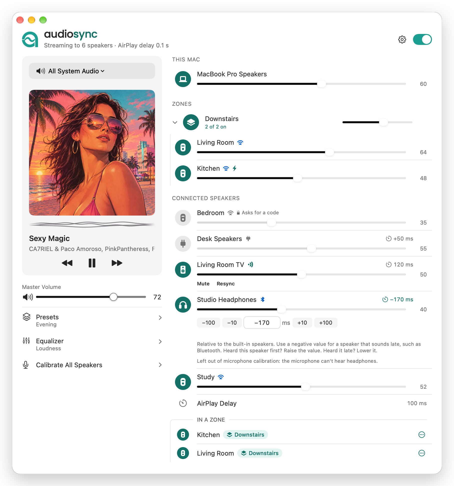
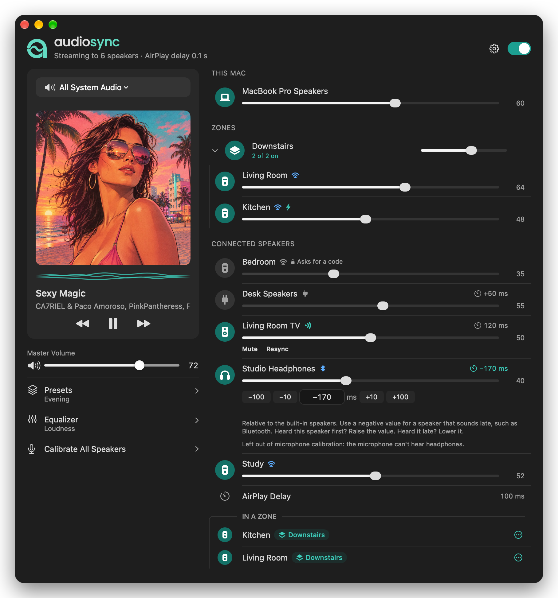

  <picture>
    <source media="(prefers-color-scheme: dark)" srcset="brand/audiosync-icon-dark.svg">
    
  </picture>
   
  <picture>
    <source media="(prefers-color-scheme: dark)" srcset="brand/audiosync-wordmark-dark.svg">
    
  </picture>

  Play your computer's sound on AirPlay, Google Cast, Bluetooth and every other speaker it knows, all at once and in sync. For macOS, Windows and Linux. A free, open-source Airfoil alternative.

  
  
  
  
  
  
  

  
  

AirPlay speakers play a little late and local speakers don't, so the same song on both turns into an echo. AudioSync grabs your computer's audio once, sends it to the network speakers and holds each local speaker back by its own delay, so everything plays together. It's the same app on macOS, Windows and Linux, and all three run the same Rust core for the audio, the sync and the AirPlay and Google Cast senders.

## What it does

- Speakers: AirPlay speakers and Apple TVs (up to 16 AirPlay 2 speakers at once, a stereo pair or an Apple TV with its HomePods as one row), Google Cast speakers and groups, and whatever your computer plays to: built-in, headphones, HDMI, USB, Bluetooth.
- Sync: a delay per local speaker, from −2 to +20 s, and one for AirPlay, set by hand or by Calibrate with Microphone, which plays a short sweep on each speaker and sets the delay from when it hears it.
- Source: all system audio, one app, several apps (or every app except a few), or an input like a mic.
- Control: volume per speaker and master, a 10-band EQ, Now Playing, zones, presets, and a Web Remote that runs in your phone's browser.

## Platforms

| | You need | Where it lives | Updates |
|---|---|---|---|
| macOS | macOS 15 or later, Apple silicon | The menu bar, plus a main window | By itself |
| Windows | Windows 11, x64 or ARM64 | A window, plus a tray icon | By itself |
| Linux | x86_64 or aarch64, glibc 2.39 or later, PipeWire | A window, plus a tray icon when your desktop has a tray | The AppImage by itself, a `.deb` by hand |

## Install

### macOS
- From Terminal, with no Open Anyway step: `curl -fsSL https://github.com/yassersutojoyo/audiosync/releases/latest/download/install.sh | bash`
- Or get `AudioSync.dmg` from the [latest release](https://github.com/yassersutojoyo/audiosync/releases/latest) and drag it to Applications. On the first launch, click Done, then System Settings → Privacy & Security → Open Anyway.
- Or with Homebrew, which installs the same DMG: `brew install --cask yassersutojoyo/audiosync/audiosync`

### Windows
- From PowerShell, no admin and no SmartScreen: `irm https://github.com/yassersutojoyo/audiosync/releases/latest/download/install.ps1 | iex`
- Or get the x64 or ARM64 zip from the [latest release](https://github.com/yassersutojoyo/audiosync/releases/latest), unzip it into its own folder and run `audiosync.exe`. If SmartScreen asks, click More info, then Run anyway.

### Linux
- From a terminal, no sudo: `curl -fsSL https://github.com/yassersutojoyo/audiosync/releases/latest/download/install-linux.sh | bash`
- Or get the AppImage for your machine from the [latest release](https://github.com/yassersutojoyo/audiosync/releases/latest), make it executable and run it.
- Or on Debian or Ubuntu, the `.deb`: `sudo apt install ./AudioSync-<version>-amd64.deb` (or `arm64`).

Each install script checks the download against the release's SHA-256 checksums; run it again to update. To build it yourself, see [`docs/DEVELOPMENT.md`](docs/DEVELOPMENT.md).

## Use

1. Pick a source.
2. Click a speaker's round icon to turn it on. Speakers that want a code or password ask when you do.
3. Speaker too early? Raise its delay. Too late? Lower it, below zero if needed. Bluetooth usually lands around −150 to −300 ms.

- For video, a player with an audio delay setting (mpv, VLC, IINA) can hold the picture back to match.
- HomePods: in Allow Speaker & TV Access, pick “Anyone on the Same Network” on a network you trust.
- On the Mac, leave the sound output on a local device, not a HomePod. The window doesn't open at login; click the Dock icon.
- On Linux, hear the source twice with no output to spare? [desktop/README.md](desktop/README.md#linux-a-silent-output) shows how to add a silent one.
- The rest is in Help > AudioSync Guide.

## Good to know

- Google Cast plays one speaker or Google Home group at a time. Cast has no shared clock, so you set its offset by ear once and it's remembered; Resync under its volume fixes drift.
- Several Bluetooth outputs at once share one radio, which shares 2.4 GHz with Wi-Fi, so they may stutter. Fewer of them, 5 GHz Wi-Fi or AirPlay for the rest helps.
- The Web Remote is plain HTTP, so I'd keep it off on networks you share with strangers.

## Something broken?

[Open an issue](https://github.com/yassersutojoyo/audiosync/issues/new/choose) with a debug log. Quit AudioSync, start it as below, do the thing again and attach the log:

- macOS, in Terminal: `AUDIOSYNC_DEBUG=1 /Applications/AudioSync.app/Contents/MacOS/AudioSync`, then attach `/tmp/audiosync-debug.log`.
- Windows, in PowerShell in the app's folder: `$env:AUDIOSYNC_DEBUG=1; .\audiosync.exe`, then attach `%TEMP%\audiosync-debug.log` ([more on the exe](desktop/README.md#running-the-exe)).
- Linux, in a terminal: `AUDIOSYNC_DEBUG=1 audiosync` (use `~/.local/bin/audiosync` after the script install, or the AppImage's path), then attach `$XDG_STATE_HOME/audiosync/debug.log` (`~/.local/state/audiosync/debug.log` when `XDG_STATE_HOME` isn't set).

## License and credits

Copyright (c) 2026 Yasser Sutojoyo Kusumo. GPL-3.0-or-later, no warranty. See [`LICENSE`](LICENSE). Stuff it bundles from others, like the Poppins font, is listed with its license in [`THIRD_PARTY_NOTICES.md`](THIRD_PARTY_NOTICES.md). The engine and the senders are my own code.

Not made by Rogue Amoeba, and no shared code with Airfoil. Apple, AirPlay and HomePod are trademarks of Apple Inc., Airfoil of Rogue Amoeba Software, LLC, and the Bluetooth® word mark of Bluetooth SIG, Inc. AudioSync isn't affiliated with or endorsed by any of them.

Building, contributing, security: [`docs/DEVELOPMENT.md`](docs/DEVELOPMENT.md), [`CONTRIBUTING.md`](CONTRIBUTING.md), [`SECURITY.md`](SECURITY.md). Privacy and signing: [`PRIVACY.md`](PRIVACY.md), [Code signing policy](docs/CODE_SIGNING_POLICY.md).

And of course, thank god for Anthropic and Claude.
