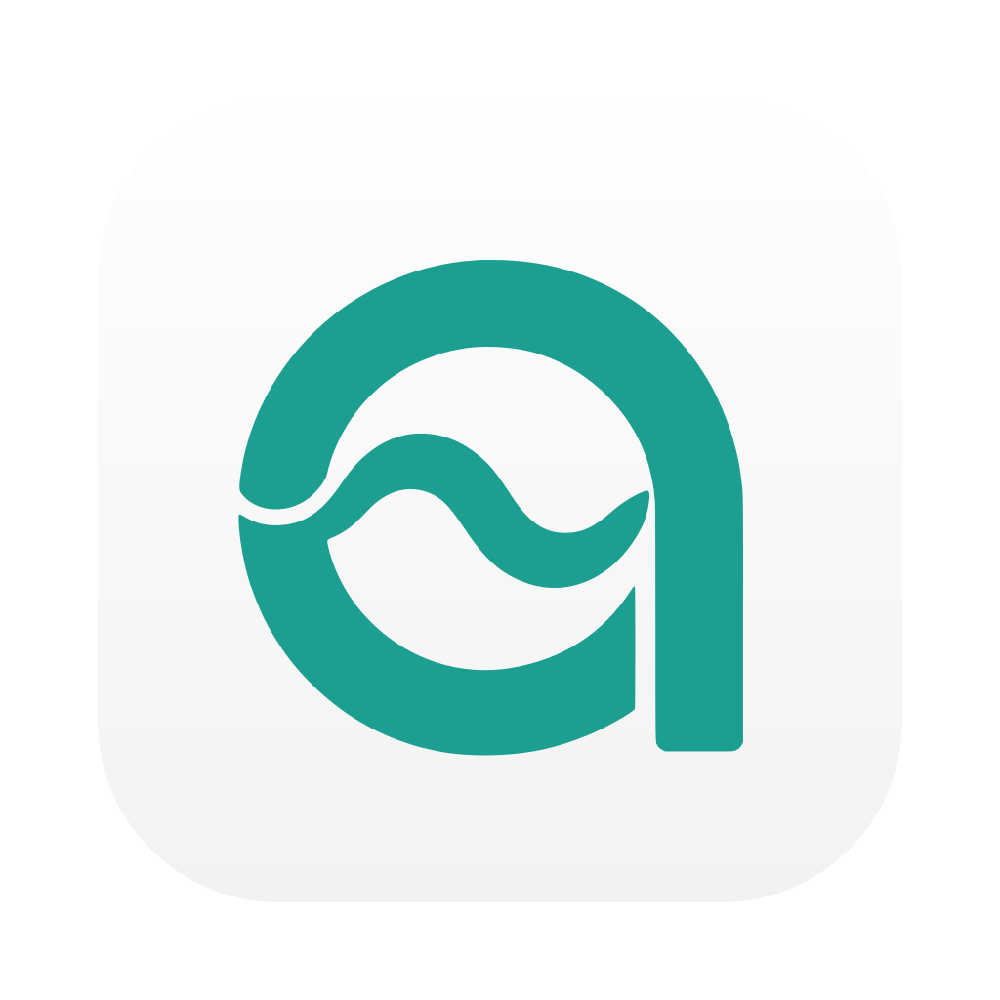
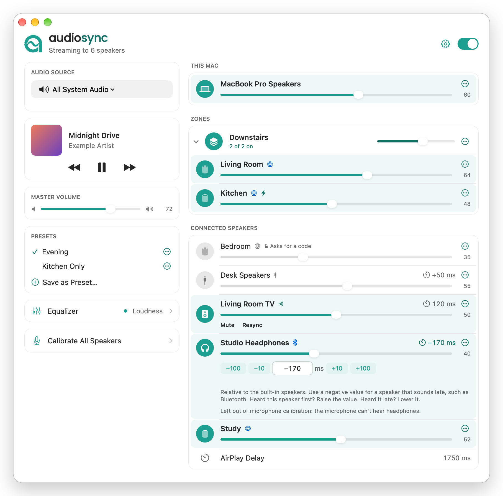

  <picture>
    <source media="(prefers-color-scheme: dark)" srcset="brand/audiosync-icon-dark.svg">
    
  </picture>
   
  <picture>
    <source media="(prefers-color-scheme: dark)" srcset="brand/audiosync-wordmark-dark.svg">
    
  </picture>

  A free, open-source Airfoil alternative for macOS: play your Mac's audio on AirPlay speakers and every local output at once, in sync.

  
  
  
  
  

  <picture>
    <source media="(prefers-color-scheme: dark)" srcset="docs/images/main-window-dark.png">
    
  </picture>

AirPlay speakers play about two seconds late. Local speakers don't. Play the same song on both and you get an echo.

AudioSync fixes that. It grabs your Mac's audio once, sends it to your AirPlay speakers, and plays a delayed copy on each local speaker, so they all line up. Mac app, menu bar panel, free, early alpha.

## What's new in 0.7

In the Mac app, and in the Windows build that's still in preview:

- Web Remote: turn it on and a phone on your home network can switch speakers on and off and set volumes and delays. It's plain HTTP, so keep it at home.
- Calibrate All Speakers measures the speakers that are on, one after the other, and lets you apply or undo the new delays in one go. It leaves out headphones and virtual outputs, since the microphone can't hear them.
- Calibrate with Microphone works on Windows too.
- AirPlay can wait up to 20 s for a Cast speaker instead of 3.
- Master Volume scales Google Cast speakers and groups too, on the device's own volume.
- A Cast speaker that doesn't show up can be added by its IP address or host name, with Add by Address… under Connected Speakers on the Mac or in the Speakers menu on Windows.
- Cast speakers show the track that's playing, with the title, artist, album and cover.
- On Windows you can rename a speaker too, with a double-click on its name.
- Hide Speaker takes a speaker you never use out of the list, and Hidden Speakers brings it back.

New in 0.6:

- Google Cast speakers, on the Mac and on Windows, one at a time. You set each one's offset by ear, and Resync restarts it if it drifts.
- Cast and AirPlay speakers together: the side that's ahead waits for the other, AirPlay up to 3 s.
- On the Mac, Calibrate with Microphone sets a local speaker's delay for you.
- On the Mac, rename a speaker with a double-click on its name.
- If the app you capture quits, AudioSync can switch to all system audio instead of stopping.
- Local speakers with a clock that runs a bit fast or slow stay in time with smaller corrections.
- Diagrams in the Guide.
- AirPlay 2 is in there, but experimental and off. See below.

The rest is in [`CHANGELOG.md`](CHANGELOG.md).

## What it does

- Source: all system audio, one app, or an input device (mic, audio interface).
- Outputs: AirPlay speakers, Apple TVs, Google Cast speakers, and anything macOS can play to (built-in, headphone jack, HDMI, USB, Bluetooth).
- A delay per local speaker (−2 to +20 s), plus one AirPlay delay.
- Volume per speaker and master, a 10-band EQ, zones (speakers that switch on and off together, with a volume of their own), auto-connect, launch at login, Now Playing for Spotify and Music.

Like Airfoil, but less. Not made by Rogue Amoeba, no shared code.

Google Cast speakers work in both the Mac and the Windows app, one at a time. Cast has no shared clock, so AudioSync can't sync them by itself: you set an offset by ear for each Cast speaker and it's remembered. If one drifts, hit Resync under its volume. That restarts the stream with a short gap, and it never happens on its own. In 0.6, speaker groups made in the Google Home app can't play. Since 0.7 a group plays as one speaker, with one volume and one offset, and its row names the members once the group reports them. A speaker in the group keeps its own row and is busy while the group plays. When a Cast speaker and AirPlay speakers are on together, the faster side waits for the slower one, but AirPlay can only wait so long: 3 s in 0.6, 20 s from 0.7. Past that a notice tells you how far ahead AirPlay plays.

## Install

- Get `AudioSync.dmg` from the [latest release](https://github.com/yassersutojoyo/audiosync/releases/latest) and drag it to Applications. Needs macOS 15 or later.
- It's not notarized, so macOS blocks the first launch. Open it once, close the warning, then click Open Anyway in System Settings → Privacy & Security. Or run `xattr -dr com.apple.quarantine /Applications/AudioSync.app`.
- Each release lists SHA-256 checksums. No auto-update: replace the app to update.
- macOS asks for Screen & System Audio Recording (choose System Audio Recording Only) and Local Network. Microphone only for an input source or Calibrate with Microphone, Automation only for Now Playing.
- HomePods: in the Home app, set Allow Speaker & TV Access to "Anyone on the Same Network", on a network you trust. Not "Everyone".
- Build it yourself: Xcode 16 command line tools, [rustup](https://rustup.rs), then `./setup.sh`. See [`docs/DEVELOPMENT.md`](docs/DEVELOPMENT.md).

## Use

- Leave the macOS sound output on a local device, not a HomePod.
- Pick a source, click a speaker's round icon to turn it on.
- The window doesn't open at login. Click the Dock icon.
- Speaker plays too early? Raise its delay. Too late? Lower it, below zero if needed. Bluetooth usually ends up around −150 to −300 ms.
- Mac plays before the HomePod? Raise the AirPlay delay. After? Lower it.
- Speakers that want a PIN or password ask for it when you turn them on. An Apple TV pairs once.
- More in the AudioSync Guide, in the gear menu.

## What doesn't work (yet)

- Everything is about two seconds late. Fine for music, bad for video and games.
- AirPlay 1 only by default. AirPlay 2 is experimental and off: to try it, turn on AirPlay 2 (Experimental) in the app menu or the gear menu, then quit and reopen AudioSync. It plays one AirPlay 2 speaker at a time and hasn't been tried on a real AirPlay 2 receiver yet. Since 0.7, with the switch on, a stereo pair, or an Apple TV with the HomePods it plays through, shows up as one speaker with one volume and one delay. Both apps show that row. No real pair has been tried yet.
- Not tried on a HomePod yet. If yours fails, [open an issue](https://github.com/yassersutojoyo/audiosync/issues/new/choose) with a log: quit AudioSync, run `AUDIOSYNC_DEBUG=1 /Applications/AudioSync.app/Contents/MacOS/AudioSync`, do it again, attach `/tmp/audiosync-debug.log`.
- Several Bluetooth outputs at once may stutter. One Bluetooth radio serves every speaker in turns and shares 2.4 GHz with Wi-Fi. AudioSync handles clock drift, but it can't fix the radio. What helps: 5 GHz Wi-Fi or a cable for the internet, fewer Bluetooth outputs, a dual-link USB transmitter, or AirPlay for the rest.
- Now Playing only works with Spotify and Music.

## Windows

A Windows 11 version (x64 and ARM64) is on the way, with the same Rust engine and its own AirPlay sender. Not released yet. CI builds it, and [windows/README.md](windows/README.md#trying-the-preview-exe) says how to try a build. It plays to AirPlay 1 and Google Cast speakers (AirPlay 2 behind the same switch as on the Mac, there in the File menu), it asks for AirPlay passwords, and it hasn't been tried on a real speaker yet.

## License and credits

Copyright (c) 2026 Yasser Sutojoyo Kusumo. GPL-3.0-or-later, no warranty. See [`LICENSE`](LICENSE). Stuff it bundles from others, like the Poppins font, is listed with its license in [`THIRD_PARTY_NOTICES.md`](THIRD_PARTY_NOTICES.md).

Apple, AirPlay and HomePod are trademarks of Apple Inc., Airfoil of Rogue Amoeba Software, LLC, and the Bluetooth® word mark of Bluetooth SIG, Inc. AudioSync isn't affiliated with or endorsed by any of them.

Building, contributing, security: [`docs/DEVELOPMENT.md`](docs/DEVELOPMENT.md), [`CONTRIBUTING.md`](CONTRIBUTING.md), [`SECURITY.md`](SECURITY.md).

And of course, thank god for Anthropic and Claude.
